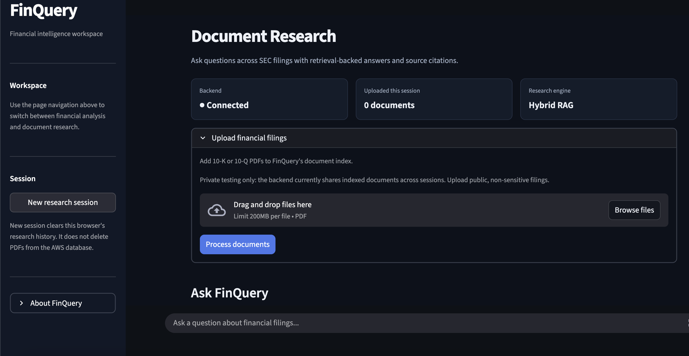

# FinQuery

**Financial-document intelligence powered by hybrid retrieval, agentic AI, and evidence verification.**

FinQuery is a full-stack financial research application that enables users to upload SEC filings (10-Ks and 10-Qs), ask natural-language questions, and receive evidence-grounded answers with document citations.

The application combines hybrid document retrieval, LangGraph-based agent orchestration, Groq-powered answer generation, and claim-level verification. Its FastAPI backend is containerized with Docker and deployed on AWS EC2, while the Streamlit frontend provides a web-based research interface.

### [🚀 Live Demo — Try FinQuery](https://finquery-2k7dhhfpgvfygjuq5hfgzr.streamlit.app/)



## Features

- **Multi-Document Analysis:** Upload and analyze multiple financial filings, including annual and quarterly reports.
- **Hybrid Retrieval:** Combines dense vector search using Qdrant with BM25 keyword retrieval.
- **Cross-Encoder Reranking:** Improves the relevance of retrieved financial passages.
- **Year-Aware Retrieval:** Filters document retrieval based on fiscal years identified in user queries.
- **Agentic RAG:** Uses LangGraph to orchestrate retrieval, answer generation, and verification.
- **Evidence Verification:** Validates citations and supporting evidence before accepting generated answers.
- **Financial Analysis:** Includes SEC XBRL-based financial comparison utilities for supported metrics.
- **Cloud Deployment:** Runs a Dockerized FastAPI backend on AWS EC2 with an HTTPS-connected Streamlit frontend.

## Tech Stack

| Category | Technologies |
|---|---|
| Language | Python |
| Backend | FastAPI, REST APIs |
| Frontend | Streamlit |
| AI / Orchestration | LangGraph, Groq |
| Vector Database | Qdrant |
| Retrieval | BM25, Sentence Transformers, Cross-Encoder Reranking |
| Infrastructure | AWS EC2, Docker, Docker Compose, Caddy |
| Evaluation | Recall@5, MRR@5, nDCG@5, Ragas |

## System Architecture

```text
                  Streamlit Frontend
                          |
                          | HTTPS
                          v
                  Caddy Reverse Proxy
                          |
                          v
                  FastAPI Backend
                          |
             +------------+------------+
             |                         |
             v                         v
       PDF Ingestion              LangGraph Agent
             |                         |
             v                         v
      Text Extraction            Hybrid Retrieval
             |                         |
             v                   +-----+-----+
         Chunking                |           |
             |                   v           v
             v                 Qdrant       BM25
      Text Embeddings            |           |
             |                   +-----+-----+
             v                         |
       Qdrant Index                     v
                               Cross-Encoder Reranking
                                         |
                                         v
                                  Groq LLM
                                         |
                                         v
                                Claim Verification
                                         |
                                         v
                              Cited Financial Answer
```

## Retrieval Performance

FinQuery's retrieval pipeline was evaluated using ** labeled financial research queries**.

Five retrieval methods were compared using the same indexed document corpus.

| Retrieval Method | Recall@5 | MRR@5 | nDCG@5 | Median Latency |
|---|---:|---:|---:|---:|
| Dense Search | 60% | 0.277 | 0.358 | 6.11 ms |
| BM25 | 45% | 0.283 | 0.323 | 2.21 ms |
| Hybrid Search | 60% | 0.353 | 0.415 | 10.10 ms |
| Hybrid + Reranking | 75% | 0.354 | 0.451 | 85.20 ms |
| **Year-Aware Reranking** | **85%** | **0.488** | **0.579** | **174.58 ms** |

### Key Results

- Achieved **85% Recall@5** using year-aware hybrid retrieval and cross-encoder reranking.
- Improved Recall@5 by **25 percentage points** compared with dense-only retrieval.
- Improved Recall@5 by **40 percentage points** compared with BM25.
- Evaluated retrieval performance using manually labeled SEC filing questions.

**Benchmark limitations:** Results are based on in-project labeled questions. Latency measurements represent warm, sequential local retrieval rather than end-to-end API response times. Results may differ across larger datasets and other document collections.

## Project Structure

```text
finQuery/
├── app/
│   ├── agents/             # LangGraph agent orchestration
│   ├── core/               # Application configuration
│   ├── database/           # Qdrant vector storage
│   ├── generation/         # LLM generation and verification
│   ├── ingestion/          # PDF parsing and chunking
│   ├── retrieval/          # Dense, BM25, hybrid, reranked search
│   ├── tools/              # Financial analysis utilities
│   └── main.py             # FastAPI application
│
├── evaluation/
│   ├── benchmark_questions.json
│   ├── retrieval_benchmark.py
│   ├── validate_labels.py
│   └── results/
│
├── streamlit_demo/
│   ├── app.py              # Streamlit frontend
│   └── requirements.txt
│
├── Dockerfile
├── compose.yaml
├── requirements.txt
└── README.md
```

## Installation

### Prerequisites

- Python 3.13
- Git
- Groq API key
- SEC-compliant User-Agent for financial data requests

### 1. Clone the repository

```bash
git clone https://github.com/WilliamSong1/finQuery.git
cd finQuery
```

### 2. Create a virtual environment

```bash
python3.13 -m venv .venv
source .venv/bin/activate
```

### 3. Install dependencies

```bash
pip install -r requirements.txt
```

### 4. Configure environment variables

Create a `.env` file in the project root:

```dotenv
ENVIRONMENT=development

GROQ_API_KEY=your_groq_api_key
GROQ_MODEL=openai/gpt-oss-20b

SEC_USER_AGENT=FinQuery Research contact@example.com

QDRANT_PATH=./data/qdrant
MAX_UPLOAD_MB=25
```

Replace placeholder values with your own credentials.

Never commit `.env` or API keys to version control.

### 5. Run FastAPI

```bash
uvicorn app.main:app --reload --port 8000
```

The API will be accessible at:

- http://localhost:8000
- http://localhost:8000/docs

### 6. Configure Streamlit

Create `.streamlit/secrets.toml` in the project root:

```toml
FINQUERY_API_URL = "http://localhost:8000"
FINQUERY_API_KEY = "your_local_api_key"
```

For local development, API-key enforcement depends on the backend environment configuration.

### 7. Run Streamlit

Open another terminal and run:

```bash
streamlit run streamlit_demo/app.py
```

Open the URL displayed by Streamlit, typically:

http://localhost:8501

## API Endpoints

| Endpoint | Method | Description |
|---|---|---|
| `/health` | GET | Check backend health |
| `/documents` | POST | Upload and index PDF filings |
| `/search` | POST | Retrieve relevant document passages |
| `/ask` | POST | Generate retrieval-grounded answers |
| `/agent/ask` | POST | Execute the LangGraph research agent |
| `/financial/compare` | POST | Analyze supported SEC financial metrics |

### Example Request

```bash
curl -X POST http://localhost:8000/agent/ask \
  -H "Content-Type: application/json" \
  -d '{"query":"How did Apple operating expenses change between 2023 and 2025?"}'
```

Production API requests also require an `X-API-Key` header.

## Docker Deployment

FinQuery's backend is containerized using Docker and Docker Compose.

Build and start the backend:

```bash
docker compose up --build -d
```

Check container status:

```bash
docker compose ps
```

View logs:

```bash
docker compose logs --tail=50
```

Persistent Docker volumes are used for Qdrant data and downloaded models.

## AWS Deployment

FinQuery is deployed with the following architecture:

```text
Streamlit Community Cloud
          |
          | HTTPS + API Key
          v
AWS EC2 / Caddy
          |
          v
Dockerized FastAPI
          |
          v
Qdrant + LangGraph + Groq
```

The deployment uses:

- AWS EC2 for backend hosting
- Docker Compose for container management
- Caddy for HTTPS and reverse proxying
- API-key authentication for backend requests
- Streamlit Community Cloud for the frontend

The FastAPI service is bound to localhost on EC2 rather than directly exposed on port 8000.

## Evaluation

FinQuery includes scripts for measuring retrieval accuracy and latency.

The benchmark evaluates:

- Recall@5
- Hit@5
- MRR@5
- nDCG@5
- Median and p95 retrieval latency

To run the retrieval benchmark:

```bash
python -m evaluation.validate_labels
python -m evaluation.retrieval_benchmark
```

Results are written to:

```text
evaluation/results/
├── retrieval_summary.csv
├── retrieval_by_category.csv
├── retrieval_details.json
└── retrieval_metadata.json
```

The benchmark requires the referenced PDF filings to be indexed locally before execution.

## Current Limitations

FinQuery is a working research prototype with several areas for future improvement:

- Uploaded documents currently share a common Qdrant collection.
- User-specific document isolation has not yet been implemented.
- Claim verification reduces unsupported answers but cannot guarantee factual accuracy.
- Groq API rate limits may affect response reliability.
- Specialized SEC XBRL comparison functionality is not yet generalized to every company or financial metric.

The application should currently be used with public, non-sensitive financial filings.

## Future Improvements

- User authentication and document-level permissions
- Per-document retrieval filtering
- Interactive document library
- Clickable source citations
- Improved numerical verification
- Broader SEC XBRL financial calculations
- Request rate limiting and usage monitoring
- Larger independent retrieval evaluations

## Disclaimer

FinQuery is an educational software engineering and financial research project. It does not provide investment advice. Financial figures and conclusions should be checked against the original SEC filings.
